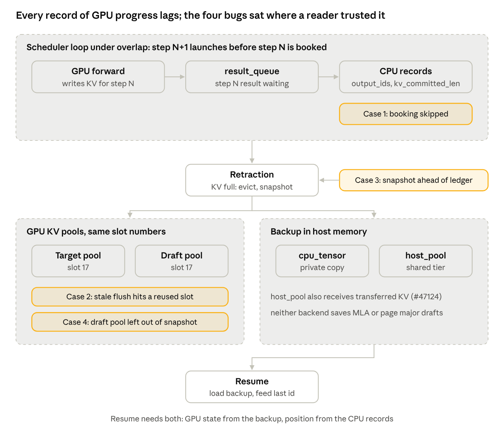

# One Invariant, Four Bugs

Jae Lee · October 31, 2026

Any record of GPU progress must be complete and current before anything consumes it as truth. Four bugs in SGLang, two on the Apple Silicon loop and two on the core PD decode path, were the same bug: a reader trusted a record the GPU had already left behind. This is what the invariant looks like in code, how each instance was found, and the checks that find the next one.

## The invariant

An inference engine runs two clocks. The GPU writes KV, advances recurrent state and commits accepted tokens as soon as a step finishes. The CPU keeps records of what the GPU did: sequence lengths, committed KV counts, output ids, which slot belongs to which request. Under overlap scheduling the CPU launches step N+1 before it has booked step N, so every record trails the GPU by at least one step. The lag is by design. The bugs come from a reader that treats a trailing record as current, or from a writer that holds a copy of a record after the record moved on.

The invariant is one sentence. Any record of GPU progress must be complete and current before anything consumes it as truth. Complete means it covers every pool and every field the consumer will touch. Current means the step that last changed the GPU has been booked.

Four mechanisms keep a lagging record safe, and every case below is a hole in one of them.

| Mechanism | Question it answers | Typical failure |
| --- | --- | --- |
| Ownership | Who holds this slot, row or buffer right now | A freed slot is reassigned while an old owner still references it |
| Completion | What signal says the GPU work on it is done | A record is read before the step that fills it is booked |
| Fence | What waits on that signal before reuse or read | A snapshot, flush or free runs ahead of the booking |
| Deadline | What happens if the signal never comes | A stuck request pins memory for every other request |

The check is mechanical. For each record a consumer reads, name the four. An empty cell is a bug or a bug waiting for a rare path to reach it.

## At a glance

The top band is the loop: the GPU writes step N, its result waits in a queue, and the CPU records trail by one step. Retraction snapshots the pools and writes the backup; resume reads the backup for state and the records for position. Each case sits on the piece it broke.

## Case 1: chained decode skips the booking

The Apple Silicon loop in SGLang replaced the standard per step function with its own, and chained decode steps back to back on the GPU without running the scheduler's allocation between them. The GPU kept writing KV. The record of how much KV had been committed, `kv_committed_len`, did not move.

A 220 token single request generation ended with `output_ids` at 220 and `kv_committed_len` at 94: the 93 prompt tokens plus one decode step. Only 94 entries of the request to token table were non zero. A follow up request with the same prefix hit the radix cache for exactly 94 of 321 tokens.

Two readers trusted the record. The radix cache inserts a finished request's KV up to the committed count, so 126 generated tokens were never cacheable. The decode KV sync looked up where each token's KV belonged through the same table; unbooked positions resolved to slot 0, the padding slot. Instrumented logging on the default configuration showed the sync resolving 164 then 56 slots, with 163 and 56 of them slot 0. Prefill's own sync line, the control, showed real sequential slots and no zeros.

Mechanism missing: completion. The GPU finished steps the CPU never booked, and nothing told the readers the count was stale.

Found by counting, not by reading. The committed length and the output length were printed at request end; the mismatch was visible in one run. The fix on the accounting side (PR #33874) called the scheduler's per step allocation once per chained step, gated on a memory check, which moved slot 0 resolutions from 219 of 220 to 0 of 220 on the same workload at no measurable cost. The PR was closed ahead of a redesign of the loop; issue #30093 carries the record.

The side finding mattered more than the fix. Enumerating every piece of state the standard loop writes per step, and checking the Apple loop against the list, produced an 18 row table with six empty cells on the Apple side. One of the eighteen described a dead write on the core path itself, a buffer published every step and read only under speculative decoding; a Meta engineer deleted that write two months later in PR #47351, and the table was the citation.

## Case 2: a deferred flush holds a stale map

The same loop deferred the write of a request's recent decode KV into the shared pool, batching the flush across steps. Retraction, which evicts requests when the KV pool is full, freed a request's slots at once. The slot table was correct the moment it changed. The flush was not; it carried the mapping it had captured before the retraction and ran afterward.

A hardware probe made the sequence explicit. After a flush left a request's synced offset at 4, one further committed decode step left one pending write. The request was retracted and its slot reassigned to a live request. The next flush wrote the retracted request's KV over the reassigned slot: the live request's value 777.0 became 104.0.

Mechanism missing: fence. Ownership changed on time; the writer never checked it before writing.

The fix in PR #30578 was two lines of fence: invalidate the request id before the row frees, and have the flush check invalidation before any row read. A regression test, red on the base and green on the patch, covered the reused slot shape. A mutation check showed it was the only test in the file sensitive to the invalidation; all nine others stayed green with the check removed, including one named for the scenario. A test that stays green with the fix removed was never testing the fix.

The instance closed by deletion. PR #43292 removed the per extend flush entirely; decode KV now enters the tree only at release, and the write the probe hit no longer exists. The invariant is unchanged. A deferred writer holding a copy of ownership is the shape to look for wherever a flush, offload or transfer runs after the record that justified it.

## Case 3: the snapshot runs ahead of the ledger

The core path has the same shape with different names. In prefill decode disaggregation, a decode server that retracts a request does not throw its state away. It copies the request's KV and recurrent state to host memory, frees the GPU slots, and restores the copy when memory returns. Resume then feeds the last entry of `output_ids` as the next input token.

Under overlap, retraction runs while the previous step's result is still queued. The backup is taken from the GPU after a full device sync, so it holds everything through step N, including a speculative verify's accepted block and a recurrent state advanced in place. `output_ids` is appended only when the CPU processes step N's result, and result processing skips retracted requests, so for this request it never is. The backup is at N; the ledger is at N minus 1; the mismatch is permanent.

On resume the restored state has already consumed the token the ledger names, so the token is consumed again. Under speculative decoding the request skips tokens or ends early. For Mamba style models the recurrent state advances twice.

Mechanism missing: fence, between the queued result and the snapshot.

PR #47482 fixes it by ordering. When a PD decode step under overlap is about to retract, process the queued result first so the ledger reaches N, drop requests that finished, re check memory because freed KV may remove the need to retract, then retract. The queue is marked drained so the loop does not process the result twice. The test fails on main by construction, device step 14 against ledger 10, and passes with the fix.

The gap is in a loop the fix cannot see. Pipeline parallel decode dispatches to its own event loop whenever the pipeline size exceeds one, keeps in flight micro batches in its own structures, and never fills the queue the fix drains. There the settle returns at once and the snapshot still runs one step ahead of the ledger. Retraction under pipeline parallel is reached by consensus across stages, so the fix would be shaped differently; the mismatch is identical.

## Case 4: the snapshot covers one pool of two

Speculative decoding runs two models, a target and a draft, each with its own KV pool. Both pools index by the same slot numbers: slot 17 in each holds that model's KV for the same token of the same request. One address, two stores with different contents.

The `cpu_tensor` retraction backup copied the request's slots from the target pool and nothing from the draft pool. After the slots were freed, the next request wrote its own KV into slot 17 in both pools. Resume restored the target KV from the backup; the draft KV was whatever the new owner had written. The draft then proposed tokens from another request's context.

Mechanism missing: ownership was tracked for one pool and not the other. The backup code was written when it knew of one pool, and the draft pool belongs to a different worker the backup never asked.

PR #47484 has the spec worker hand its draft pools to the allocator at startup; backup copies them with the target KV and restore loads them back. The test round trips two draft pools through slot relocation and checks the bytes.

The fix's own filter leaves the hole open for three pool shapes. Only full slot MHA pools qualify. MLA pools localize token ids per rank, page major pools have no CPU copy, and a DFlash compact cache keeps its own row table, so those drafts are skipped, with no refusal at startup and no abort at retraction. For them the request still resumes on another request's draft KV, now by design. The repo already has both honest alternatives in neighboring code: a startup check that refuses an unsupported backend combination, and a retraction path that aborts a request when its backup cannot be taken. Either beats a silent wrong answer. The configurations affected include multi token prediction drafts on MLA targets, which are the models the project ships first.

The `host_pool` backend, the newer shared host tier that also receives transferred KV, already carries draft KV: its backup adds a draft pool transfer, and the page envelope receive path refuses packed draft pools at startup. Only the older `cpu_tensor` backend had the gap.

## The method

Four cases, two found by instrumenting a running server and two by reading a diff against the loop it runs in. The same two tools produced all four.

**The contract table.** Enumerate every piece of state a step must write, one row each, one column per loop that claims to implement the step. Fill each cell with where the write happens or leave it empty. The table for SGLang's decode step has 18 rows (RFC #32833). The Apple loop left six empty, and each empty cell was a bug found later, one at a time, by someone else. The table is cheap to build and expensive to skip, because the alternative is finding the rows by production incident. It also found one dead write on the reference loop, which is the kind of thing a table shows and a reader of either loop alone does not.

**The four mechanism check.** For any record a consumer reads, ask ownership, completion, fence, deadline. Case 1 lacked completion, case 2 a fence, case 3 a fence, case 4 ownership. The check is fast enough to run on every PR that touches retraction, offload, transfer or flush, which are the paths where a record and the GPU separate by design.

**Verification rules, each learned from a case where the obvious check lied.**

| Rule | What it caught |
| --- | --- |
| Red on base before green on patch | A test that passes on both proves nothing about the fix |
| Mutation check: remove the fix, rerun the suite | Nine of ten tests in a file stayed green without the fence; only the new one was testing it |
| Run the CI lane's own command, not the local runner | pytest reported 220 passing while the lane failed at collection on a missing main block |
| Verify artifacts, not notifications | A background job reported done after five seconds having written nothing |
| Public claims copy from reports, never from recollection | A posted comment said a fix covered K=1408; the report from the same morning said it did not |

**What the method is not.** It is not a test suite and cannot be replaced by one. A test checks a question someone already asked. PR #7, the redesign of the Apple loop, passed every test it had while shipping without overlap scheduling; no test asked for overlap. The table and the four mechanisms are how the question gets asked before the test exists.

## Sources

| Case | Record | Reference |
| --- | --- | --- |
| 1 | Chained decode accounting | [Issue #30093](https://github.com/sgl-project/sglang/issues/30093), [PR #33874](https://github.com/sgl-project/sglang/pull/33874) |
| 1 | Per step contract table | [RFC #32833](https://github.com/sgl-project/sglang/issues/32833), [PR #47351](https://github.com/sgl-project/sglang/pull/47351) |
| 2 | Retraction flush | [PR #30578](https://github.com/sgl-project/sglang/pull/30578), [Issue #33547](https://github.com/sgl-project/sglang/issues/33547), [PR #43292](https://github.com/sgl-project/sglang/pull/43292) |
| 3 | Retraction snapshot ordering | [PR #47482](https://github.com/sgl-project/sglang/pull/47482) |
| 4 | Retraction snapshot coverage | [PR #47484](https://github.com/sgl-project/sglang/pull/47484) |
| Method | Apple loop redesign | [yeahdongcn/sglang PR #7](https://github.com/yeahdongcn/sglang/pull/7) |
